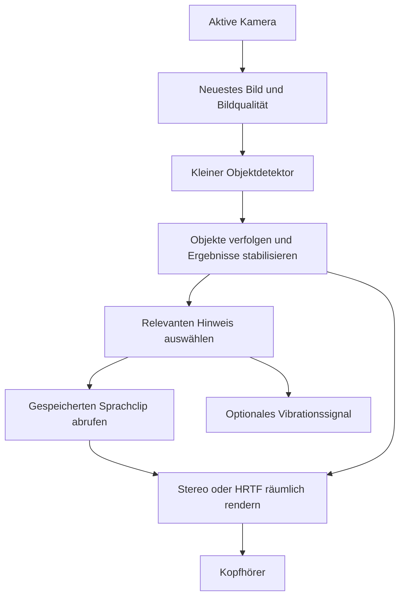

# Plan: Räumlich sprechende Kameraassistenz für blinde Menschen

Stand: 17. November 2026. Dies ist ein Entwicklungsplan. Laufzeit, Erkennungsqualität und Stromverbrauch sind noch nicht auf Geräten gemessen.

## 1. Produktziel

Eine App für iOS und Android, die nach dem Öffnen die Kamera aktiviert, ausgewählte Objekte erkennt und kurze Hinweise aus deren Richtung wiedergibt. Die Verarbeitung läuft auf dem Telefon. Die Grundfunktion braucht weder Internet noch Konto.

Beispiel: Eine Treppe erscheint links. Die App sagt „Treppe“ aus der linken Richtung. Verschiebt sich die Treppe im Kamerabild, wandert die Audioquelle während der Wiedergabe mit. „Treppe aufwärts“ beziehungsweise „Treppe abwärts“ kommen hinzu, sobald diese Unterscheidung gesondert ausreichend geprüft wurde.

Die App ergänzt Langstock und Blindenführhund. Sie ist zunächst eine Orientierungshilfe in einem definierten, betreut getesteten Einsatzbereich. Aus einer fehlenden Erkennung folgt keine Aussage über einen freien oder sicheren Weg.

## 2. Bedienung ohne Sichtkontakt

- Nach einer einmaligen, gesprochenen Einrichtung und Kamerafreigabe startet beim Öffnen unmittelbar der Scanmodus.
- Die Rückkamera ist die Voreinstellung. Front- und Rückkamera sind auswählbar; zunächst ist immer nur eine aktiv.
- Vier beschriftete, mit VoiceOver und TalkBack erreichbare Aktionen: Pause/Start, Hinweis wiederholen, Kamera wechseln, Einstellungen.
- Keine exklusiven Wisch- oder Tippgesten, die mit dem Screenreader kollidieren. Zusätzliche Kurzbefehle werden auf beiden Plattformen gesondert geprüft.
- Sehr einfache Oberfläche, große Bedienelemente und optional hoher Kontrast für Menschen mit Sehrest.
- Gesprochene beziehungsweise haptische Rückmeldung zu Kamerawahl, Pause und erkennbaren Betriebsunterbrechungen.
- Kurzer hörbarer Links-Rechts-Test in der Einrichtung. Alternativmodus für Monoausgabe oder einseitiges Hören: Richtungswörter wie „links“ und „rechts“, ergänzt durch unterscheidbare Vibrationsmuster.
- Automatische Ansagen und die Sprachausgabe des Screenreaders werden über Audiofokus und Unterbrechungsregeln koordiniert und praktisch getestet.

Offene Stereokopfhörer sind eine zu testende Ausgabeform, damit Umgebungsgeräusche wahrnehmbar bleiben. Auch Knochenleitung wird mit Testpersonen geprüft; ausreichende Richtungsunterscheidung wird dabei nicht vorausgesetzt. Bei Kopfhörertrennung stoppt der räumliche Modus und die App meldet den Wechsel, soweit das Betriebssystem dies zulässt.

Für den ersten Einsatz wird eine klar erklärte Telefonhaltung verwendet: mittig vor dem Körper, aktive Kamera in Blickrichtung der zu untersuchenden Umgebung. Eine Halterung ist als eigene Variante zu testen. Die App muss auch darauf hinweisen können, dass das Bild zu dunkel oder die Kamera derzeit nicht nutzbar ist, soweit dies erkennbar ist.

## 3. Verarbeitung auf dem Telefon

Die Objekterkennung liefert Klasse, Bildposition, Zeitstempel und Modellscore. Ein leichter Tracker hält Objektidentitäten und Positionen zwischen Erkennungen aktuell. Der Score ist keine garantierte Wahrscheinlichkeit, dass eine Aussage stimmt.

Es gibt keine wachsende Warteschlange von Kamerabildern. Bei ausgelasteter Verarbeitung wird das neueste verfügbare Bild verwendet. Android CameraX unterstützt dafür `STRATEGY_KEEP_ONLY_LATEST`. Alte Ergebnisse verlieren nach einem festgelegten Zeitlimit ihre Gültigkeit; veraltete Ansagen werden verworfen oder beendet. [CameraX-Bildanalyse](https://developer.android.com/media/camera/camerax/analyze)

Im normalen Erkennungspfad sind weder ein Sprachmodell noch ein generatives Bildbeschreibungsmodell erforderlich. Eine feste Zuordnung übersetzt Objektklassen in geprüfte Ansagen.

## 4. Modellwahl für die Kamera

Zunächst zwei Kandidaten auf echten Telefonen vergleichen. Die Entscheidung fällt anhand der gesamten App-Pipeline, einschließlich Vorverarbeitung, Ergebnisstabilisierung, Energieverbrauch und Exportkompatibilität.

| Kandidat | Nachgewiesene Ausgangsbasis | Rolle im Vergleich |
| --- | --- | --- |
| EfficientDet-Lite0 INT8 | Google nennt 4,4 MB für das quantisierte Modell; Eingabe 320 × 320 | Kompakte Ausgangsbasis, eigenes Training für zusätzliche Klassen |
| YOLO26n | 2,4 Millionen Parameter; Core-ML-Export dokumentiert | Zweiter Kandidat für Qualität, Laufzeit und mobile Bereitstellung |

Die Größenangabe ist weder RAM-Bedarf noch Größe der gesamten App. Googles 37-ms-Wert für EfficientDet-Lite0 wurde auf einer Pixel-4-CPU mit vier Threads gemessen und ist keine Zusage für diese App. Modellwerte und Messbedingungen: [Google](https://developers.google.com/edge/litert/libraries/modify/object_detection), [YOLO26](https://docs.ultralytics.com/models/yolo26/), [Core-ML-Export](https://docs.ultralytics.com/integrations/coreml/).

INT8 und FP16 werden pro Zielplattform praktisch verglichen. Ein kleineres Modell ist nicht automatisch auf jedem Beschleuniger schneller oder sparsamer. Insbesondere darf eine niedrigere Eingabeauflösung nicht die Erkennung kleiner oder weiter entfernter Stufen unbemerkt verschlechtern.

Ultralytics bietet AGPL-3.0 und eine Enterprise-Lizenz an; die zur geplanten Veröffentlichung passende Variante gehört zur Auswahlentscheidung. Beim ausgewählten Google-Modell werden ebenso die konkreten Gewichte, Trainingsdaten und Lizenztexte geprüft. [Ultralytics-Lizenzmodell](https://www.ultralytics.com/license)

## 5. Treppen sind ein eigener Entwicklungsbaustein

Die üblichen COCO-Modelle enthalten unter ihren 80 Klassen weder Treppen noch Türen oder Bordsteinkanten. Ein Standardmodell allein erfüllt das Treppenbeispiel daher nicht. [COCO-Klassenliste](https://raw.githubusercontent.com/ultralytics/ultralytics/main/ultralytics/cfg/datasets/coco.yaml)

Vorgesehene Ausbaustufen:

1. Allgemeine Objekte wie Personen, Fahrräder und Stühle für den technischen Kameratest.
2. Eigenes Training für „Treppe“ und „Tür“; generische Treppenansage in kontrollierten Tests.
3. Treppen aufwärts/abwärts, einzelne Stufen und Bordsteinkanten als gesondert geprüfte Erweiterung. Falls nötig, zusätzliche Geometrie-, Segmentierungs- oder Tiefeninformation.

„Aufwärts“ beziehungsweise „abwärts“ lässt sich nicht aus der linken oder rechten Position eines Rechtecks ableiten. Bei unklarer Richtung bleibt die Ansage allgemein. Ansagen beschreiben die Situation; sie geben keine Aufforderung, eine Treppe zu betreten.

Trainings- und Testmaterial muss echte Nutzung abbilden: unterschiedliche Telefonhöhen und Neigungen, beide Kameras, Innen- und Außenräume, Schatten, Gegenlicht, Teppich, reflektierende Stufen, Teilverdeckungen und Bewegungsunschärfe. Negative Beispiele wie Streifenmuster, Rampen und Geländer sind wesentlich.

Training und unabhängige Tests werden nach Gebäuden, Orten und Aufnahmevorgängen getrennt. Benachbarte Videoframes dürfen nicht als scheinbar unabhängige Trainings- und Testbeispiele dienen. Der Datenbedarf wird nach einem ersten Datensatz anhand der auftretenden Fehler erweitert; eine feste Bilderzahl garantiert keine Einsatzqualität.

## 6. Sprache und Phonon

`phonon:multilingual` ist auf Ollama mit **123 MB** gelistet. Es ist ein Text-to-Speech-Modell für Deutsch, Englisch, Französisch, Spanisch und Portugiesisch. Die Ausgabe ist Monoaudio mit 24 kHz; die räumliche Platzierung übernimmt anschließend die App. Das Modell erkennt keine Kamerabilder. [Ollama-Modellseite](https://ollama.com/library/phonon:multilingual)

Der Hersteller verlinkt native Integrationen: Swift/Core ML für iPhone und eine Android-Bibliothek mit C-Schnittstelle beziehungsweise Kotlin-Anbindung. Die geprüfte Swift-Anleitung setzt iOS 18 voraus. Android benötigt derzeit einen eigenen Bibliotheksbuild; eine Snapdragon-NPU-Variante wird als Vorschau geführt. Das ist eine brauchbare Integrationsbasis, aber noch kein Leistungsnachweis für unsere App. [Hersteller-Modellkarte](https://huggingface.co/gradium/phonon-40m-multilingual), [Swift](https://github.com/gradium-ai/xn-ptts/blob/main/ios/PhononTTS/README.md), [Android](https://github.com/gradium-ai/xn-ptts/blob/main/android/README.md)

Empfohlener Einsatz:

- Häufige Hinweise als vollständige, vorab erzeugte und angehörte Clips: etwa „Treppe“, „Treppe abwärts“, „Tür“, „Person“ und Betriebszustände.
- Die App lädt die benötigten Clips vor und spielt sie ohne Sprachsynthese im zeitkritischen Pfad ab.
- Phonon zunächst für die Herstellung und Bewertung der Sprachpakete nutzen. Eine native Einbindung auf dem Telefon ist später für frei formulierte Hinweise möglich.
- Falls freie Sprache hinzukommt, wiederkehrende Ergebnisse zwischenspeichern und den zusätzlichen Speicher- und Strombedarf messen.
- Erst Deutsch, anschließend weitere Sprachpakete nach Sprach- und Verständlichkeitstests.

Rechenbeispiel für die Planung: 100 Clips mit durchschnittlich einer Sekunde Länge benötigen bei 24 kHz, 16 Bit und Mono ungefähr 4,8 MB unkomprimierte Audiodaten. Mehrere Richtungen erfordern keine Kopien desselben Clips, weil die Richtung beim Abspielen berechnet wird.

Die mehrsprachigen Phonon-Gewichte stehen unter CC BY-NC 4.0. Für eine kommerzielle Veröffentlichung muss eine passende Erlaubnis beziehungsweise eine andere Sprachquelle gewählt werden; auch die Nutzungsrechte an Stimmen und erzeugten Sprachpaketen müssen zur Veröffentlichung passen. Vorbereitete Audiodateien werden nicht als automatischer Ausweg aus Lizenzbedingungen behandelt. [Herstellerangaben zur Lizenz](https://huggingface.co/gradium/phonon-40m-multilingual)

## 7. Räumliche Ausgabe

Die Audioquelle bleibt während des gesamten Clips an das verfolgte Objekt gekoppelt. Ihre Position wird laufend aktualisiert und geglättet. Ein lediglich einmal links oder rechts abgespielter Clip würde die gewünschte Bewegung nicht vollständig abbilden.

Zwei Verfahren werden direkt mit blinden Testpersonen verglichen:

- **Stereo-Panning:** günstige Berechnung, kontinuierlicher Übergang von links nach rechts.
- **Binaurale HRTF-Ausgabe:** zusätzliche Filter für Richtungseindrücke. Ob dies gegenüber Stereo hilft, wird pro Kopfhörertyp und mit unterschiedlichen Personen getestet. Die erste Version vermittelt vor allem die horizontale Richtung.

Apple stellt entsprechende Algorithmen über `AVAudioEnvironmentNode` bereit. Diese dienen als native iOS-Referenz. Parallel wird Steam Audio für direktes HRTF-Rendering auf beiden Plattformen verglichen, mit Oboe für die Android-Audioausgabe. BRT kommt als zweiter Bibliothekskandidat hinzu. Nur die direkte räumliche Wiedergabe wird benötigt; Raumsimulation, Hall, Echo, Doppler und automatische Umlaufbahnen gehören nicht in den ersten Hinweisstrom. [Apple-Algorithmen](https://developer.apple.com/documentation/avfaudio/avaudio3dmixingrenderingalgorithm), [Oboe](https://developer.android.com/games/sdk/oboe), [Steam-Audio-HRTF](https://valvesoftware.github.io/steam-audio/doc/capi/hrtf.html), [BRT](https://github.com/GrupoDiana/BRTLibrary)

Wichtige Koordinatenregeln:

- Der erste technische Test bildet Bildposition auf Stereoposition ab. Für eine geometrisch passende Richtung wird danach der tatsächliche Kamerablickwinkel berücksichtigt, einschließlich Zuschnitt und Rotation.
- Eine gespiegelte Selfie-Vorschau darf die Zuordnung zur realen Richtung nicht umkehren. Ein Kamerwechsel kehrt die Blickrichtung physisch um; er ist keine einfache Spiegeloperation.
- Ohne bekannte Ausrichtung zwischen Telefon und Kopf beziehen sich Richtungen nur auf die aktive Kamera. Eine beliebige Telefonhaltung erlaubt keine zuverlässig auf den Körper bezogene Aussage.
- Kopftracking ist eine spätere Erweiterung für geeignete Kopfhörer und Geräte. Es erfordert eine Kalibrierung zwischen Kamera, Telefon und Kopf; ein HRTF-Filter allein liefert diese Zuordnung nicht.
- Die Tonposition bezeichnet zunächst eine Richtung. Sie behauptet keine gemessene Entfernung und keine dauerhaft bekannte Weltposition.

### 7.1 Prüfung der vorgeschlagenen Audio-Werkzeuge

Quellenstand: 17. November 2026. Die folgende Zuordnung ist eine technische Auswahl für dieses Projekt, kein bereits gemessener Leistungsvergleich.

| Werkzeug | Geprüfte Grundlage | Geplanter Nutzen |
| --- | --- | --- |
| Binauro | Kostenloser Browser-Renderer; die Nutzungsbedingungen untersagen Weiterverteilung des Dienstes und erlauben keine Übernahme seines Codes. Für erzeugte Audiodateien nennen sie auch kommerzielle Verwendung. [Bedingungen](https://binauro.com/terms) | Schnelle Hörprobe im Browser; derzeit keine frei einbaubare Codebasis |
| IEM Plug-in Suite | Offene Ambisonics-Plugins unter GPLv3, einschließlich BinauralDecoder. [Projekt](https://plugins.iem.at/), [Decoder](https://plugins.iem.at/docs/plugindescriptions/) | Referenz für Hörvergleiche am Entwicklungsrechner; der Ambisonics-Arbeitsablauf ist für die erste einzelne Hinweisstimme nicht erforderlich |
| OpenSpatialDelay | Offener räumlicher Delay-Effekt für VST3/AU unter GPL-3.0; zusätzliche Bedingungen je verwendetem HRTF-Datensatz. [Quellcode](https://github.com/Spatial-Media-Lab/OpenSpatialDelay) | Code- und Klangreferenz; kein fertiges iOS-/Android-SDK |
| Binaural Rendering Toolbox (BRT) | Modulare C++-Bibliothek unter GPLv3 oder später; das Projekt nennt ein iOS-Beispiel. [Quellcode und Dokumentation](https://github.com/GrupoDiana/BRTLibrary) | Direkter Kandidat für einen eigenen mobilen Renderer. Android-Build, Bibliotheksgröße und Energiebedarf müssen erst praktisch nachgewiesen werden |
| Orbit / OVNI Audio | Aktuell als kostenloses Desktop-Plugin dokumentiert. Die geprüfte Produktseite liefert keine nachprüfbare Open-Source-Lizenz; der in Verzeichnissen genannte Quellcode unter `ovniaudio/orbita` war bei der Prüfung nicht abrufbar. Laut Handbuch ist der HRIR-Ring horizontal und der Höhenregler eine Klangfärbung. [Produkt](https://ovniaudio.com/orbit), [Handbuch](https://ovniaudio.com/orbit-manual) | Für horizontale Hörvergleiche verwendbar; bis zu zugänglichem Quellcode und Lizenz nicht als App-Codebasis einplanen |
| Binaspect | Python-Werkzeuge für binaurale Signalanalyse, etwa Laufzeit- und Pegelunterschiede zwischen den Ohren; Apache-2.0. [Projekt](https://github.com/QxLabIreland/Binaspect), [Lizenz](https://github.com/QxLabIreland/Binaspect/blob/main/LICENSE) | Entwicklung und Qualitätssicherung außerhalb der App; Analyse von Renderern, Kompression und Links-Rechts-Fehlern |
| Steam Audio | C-API, Unterstützung für iOS und Android, Apache-2.0. [Plattformen](https://valvesoftware.github.io/steam-audio/), [Lizenz](https://github.com/ValveSoftware/steam-audio/blob/master/LICENSE.md) | Erster Kandidat für eine gemeinsame mobile HRTF-Implementierung; nur den benötigten direkten Renderpfad benutzen |

Für alle eingebundenen HRTF-Daten werden Herkunft und konkrete Nutzungsbedingungen separat festgehalten. Die Lizenz einer Bibliothek ist nicht automatisch die Lizenz sämtlicher Messdaten.

Der erste Audiovergleich verwendet dieselben Mono-Sprachclips und dieselben vorgegebenen Bewegungen: links–Mitte–rechts, langsamer Kameraschwenk, schnelle Richtungsänderung und Verlassen des Bildes. Verglichen werden Stereo-Panning, Apples Renderer, Steam Audio und – nach erfolgreichem mobilen Build – BRT. Gemessen werden Positionsaktualisierung, zusätzliche Audiolatenz, Aussetzer, Speicherbedarf und Energieverbrauch auf denselben Telefonen.

Mit blinden Testpersonen werden daneben Richtungsverwechslungen, Ortungsfehler, Verständlichkeit, Höranstrengung und Wahrnehmbarkeit der Umgebung verglichen. Binaspect kann technische Signalfehler aufzeigen; solche Messwerte ersetzen diese Nutzungstests nicht. Die HRTF-Auswahl fällt anhand dieser Ergebnisse. Es gibt noch keinen Nachweis, welches Verfahren für diese App am besten funktioniert.

## 8. Welche Objekte gesprochen werden

Die App zählt nicht fortlaufend alles auf. Ein auswählbarer, sparsamer Hinweisstrom soll die Umgebung akustisch verständlich halten.

- Standardmäßig eine Sprachquelle gleichzeitig.
- Bereits bekannte, unveränderte Objekte werden nicht bei jedem Bild erneut angesagt.
- Ein neuer, relevanter Hinweis kann eine weniger wichtige Ansage unterbrechen.
- Bei konkurrierenden Objekten entscheiden Erkennungsstabilität, relevante Klassen und deren Lage im untersuchten Bereich. Ohne Tiefeninformation wird daraus keine zuverlässige Kollisionsvorhersage abgeleitet.
- Erneute Ansage bei relevanter Änderung, Wiederauftauchen oder ausdrücklichem Wiederholen.
- Optional ein leises, abschaltbares Ortungssignal für genau ein ausgewähltes Objekt zwischen Sprachhinweisen.
- Unsichere Ergebnisse werden nicht durch frei erfundene Einzelheiten ergänzt. Die notwendige Abwägung zwischen ausgelassenen Hinweisen und Fehlalarmen wird anhand der jeweiligen Objektklasse getestet.

Eine lange Sprachwarteschlange ist ausgeschlossen. Vor der Wiedergabe muss geprüft werden, ob Objekt und Hinweis noch aktuell sind. Ein optionales, sparsames Betriebssignal bestätigt ausschließlich, dass die App arbeitet, niemals einen sicheren Weg.

## 9. Native App-Architektur

| Bereich | iOS | Android |
| --- | --- | --- |
| Oberfläche | Swift/SwiftUI mit VoiceOver | Kotlin/Compose mit TalkBack |
| Kamera | AVFoundation | CameraX |
| Inferenz | Core ML, sofern der gewählte Export funktioniert; LiteRT als zu prüfende Alternative | Gebündeltes LiteRT, geeigneter Hardware-Backend nach Messung |
| Audio | AVAudioEngine und Environment Node | Oboe und HRTF-Renderer |
| Optionale freie Sprache | Phonon über native Swift-Integration | Phonon über native Bibliothek |
| Gemeinsame Grundlage | Klassenkatalog, Audioassets, Testfälle, Zeitstempel- und Prioritätsregeln | Dieselben Spezifikationen und Assets |

Native Oberflächen geben direkten Zugang zu Kamera, Audiounterbrechungen und Bedienungshilfen. Ein gemeinsamer C++-Baustein wird nur dort eingesetzt, wo er tatsächlich Doppelarbeit reduziert; die erste Version braucht keinen großen zusätzlichen Anwendungsrahmen.

Android-Hardwarebeschleunigung wird pro Chipsatz geprüft. GPU oder NPU sind nicht auf jedem Gerät und für jeden Operator gleichermaßen verfügbar. Ein gebündelter Runtime- und Modellpfad soll den Kernbetrieb auch ohne Netz ermöglichen. [LiteRT](https://developers.google.com/edge/litert/overview), [NPU-Unterstützung](https://developers.google.com/edge/litert/android/npu/overview)

## 10. Geschwindigkeit und Energie

Die folgenden Zahlen sind Entwicklungsziele für festzulegende Referenzgeräte, keine gemessenen Produkteigenschaften:

| Größe | Erstes Ziel und Messung |
| --- | --- |
| Betriebsbereitschaft | Möglichst innerhalb von 1–2 Sekunden nach dem Öffnen; einmalige Freigaben und Modellvorbereitung separat betrachten |
| Erkennungsrate | Zunächst ungefähr 10–15 Auswertungen pro Sekunde; schneller nur bei nachgewiesenem Nutzen |
| Tracking | Zwischen den Erkennungen mit verfügbaren Kamerabildern, etwa 15–30 Aktualisierungen pro Sekunde |
| Neue Ansage | Zielwert p95 höchstens 300 ms vom sichtbaren Auftauchen bis zum hörbaren Beginn im unbelasteten Scanmodus auf Referenzgeräten mit kabelgebundenem Audio |
| Audiowege | Kabel, Lautsprecher und verschiedene Bluetooth-Kopfhörer getrennt messen |
| Dauerbetrieb | 30–60 Minuten pro Gerätekonfiguration; Energie, Temperatur, Drosselung und Erkennungsfehler gemeinsam erfassen |

Bei der Latenz zählen auch die Wartezeit bis zum nächsten Scan, Belichtung, Bildaufbereitung, Stabilisierung und Audiopuffer. Die Zahl „Modell braucht 30 ms“ beschreibt das Nutzererlebnis daher nicht vollständig. Latenz bei bereits laufender Ansage und nach einer Unterbrechung wird zusätzlich protokolliert.

Stromsparmaßnahmen in sinnvoller Reihenfolge:

1. Gespeicherte Sprachclips im Dauerbetrieb verwenden.
2. Hardwarebeschleunigung nach Energie- und Qualitätsmessung auswählen; CPU-Fallback begrenzen und testen.
3. Kameraauflösung und Bildrate auf den tatsächlich nötigen Bereich beschränken.
4. Kopien und Farbraumkonvertierungen reduzieren; Puffer und Audioressourcen wiederverwenden.
5. Erkennung und Tracking sinnvoll aufteilen. Ein optionaler Sparmodus wird ausdrücklich angekündigt und separat validiert; ein stillstehendes Telefon allein ist kein Grund, bewegte Hindernisse langsamer zu erfassen.
6. Kameravorschau optional ausblenden und Display abdunkeln. Der Kernbetrieb bleibt zunächst im Vordergrund; Bildschirmsperre oder Hintergrundbetrieb werden nicht vorausgesetzt.
7. Beim Pausieren Kamera und Erkennung tatsächlich stoppen.

Eine verlässliche Angabe in Prozent Akku pro Stunde ist erst nach Gerätemessungen möglich. Verglichen werden Kamera allein, Kamera mit Erkennung, räumliche Clipausgabe und zusätzlich aktive Sprachsynthese. So wird sichtbar, welche Komponente welchen Verbrauch verursacht.

## 11. Entfernung und weitere Fähigkeiten

Eine Objektbox im zweidimensionalen Bild ist keine verlässliche Entfernungsmessung. Der Basismodus spricht daher keine exakten Meterangaben.

Optional später: LiDAR-basierte ARKit-Tiefe auf unterstützten Apple-Geräten beziehungsweise ARCore Depth auf geeigneten Android-Geräten. Beide müssen je Kamerawahl und Gerät auf Verfügbarkeit, Qualität und Energieverbrauch geprüft werden. Auch Tiefendaten allein lösen die Erkennung von Abwärtsstufen nicht. [Apple-Szenentiefe](https://developer.apple.com/documentation/arkit/arconfiguration/framesemantics-swift.struct/scenedepth), [ARCore-Tiefe](https://developers.google.com/ar/develop/java/depth/developer-guide)

Die Ollama-Liste bleibt für eine spätere, ausdrücklich angeforderte Szenenbeschreibung interessant: etwa ein einzelnes Bild auf „Was ist hier?“. Das ist ein eigener Betriebsmodus mit eigenem Modell, zusätzlichem Speicherbedarf und gesonderter Latenzprüfung. Er gehört nicht in den kontinuierlichen Hinweisstrom der ersten Version. [Ollama-Vision-Modelle](https://ollama.com/library?c=vision)

## 12. Tests und Freigabekriterien

Blinde und sehbehinderte Menschen werden ab der ersten Audioprobe beteiligt, zusammen mit Erfahrung aus Orientierung und Mobilität. Ein Versuch mit sehenden Personen und geschlossenen Augen ersetzt diese Beteiligung nicht.

Geprüft werden insbesondere:

- Werden Links und Rechts auch beim Schwenken und nach dem Kamerawechsel richtig verstanden?
- Hilft HRTF im Vergleich zu Stereo bei der Ortung, und bleibt die Sprache verständlich?
- Wie oft werden relevante Treppen verpasst oder zu spät angesagt, und wie oft entstehen Fehlalarme pro Minute?
- Wie häufig werden aufwärts und abwärts verwechselt? Bei welchen Licht-, Blickwinkel- und Oberflächenbedingungen?
- Stören Wiederholungen, Unterbrechungen oder gleichzeitig laufende Bedienungshilfen?
- Was passiert bei fehlender Kamerafreigabe, verdeckter Kamera, dunklem Bild, altem Frame, Kopfhörertrennung, Anruf und App-Unterbrechung?
- Bleiben Laufzeit, Temperatur und Qualität auch auf einem älteren iPhone und einem Android-Mittelklassegerät brauchbar?

Berichte enthalten je Klasse die Fehlertypen, Erkennungsquote, Fehlalarmrate und Zeit bis zur Ansage; zusätzlich die Bedingungen und Unsicherheit der Messung. Ein allgemeiner Durchschnittswert oder ein hoher Modellscore reicht für Treppenhinweise nicht aus.

Vor jedem Pilotabschnitt werden Einsatzbereich und konkrete Abbruchkriterien festgelegt. Zunächst kontrollierte Innenräume mit Begleitung; Außenbereiche und weitere Gefahrenklassen folgen nach eigener Prüfung. Es gibt keine pauschale Aussage „erkennt alle Hindernisse“.

Standardmäßig werden Kamerabilder weder gespeichert noch übertragen. Trainingsaufnahmen und Fehlerbeispiele erfordern eine separate, ausdrückliche Aufnahmefunktion mit klarer Einwilligung und Löschmöglichkeit.

## 13. Entwicklungsreihenfolge

Grobe Planung für ein kleines erfahrenes Team mit verfügbaren Testgeräten und Testpersonen. Datenbeschaffung und Qualität können die Dauer wesentlich verändern.

| Phase | Ungefährer Zeitraum | Konkretes Ergebnis |
| --- | --- | --- |
| 1. Nutzung und Audio | Woche 1 | Mit Testpersonen gewählte Hinweise und Telefonhaltung; Stereo-/HRTF-Vergleich mit bewegter Tonquelle; Phonon-Stimme bewerten |
| 2. Technischer Durchstich | Woche 2 | Kamerabild → Standarddetektor → verfolgte Position → Clip auf je einem iPhone und Android-Gerät; erste Latenz- und Energiemessung |
| 3. Zielklassen | Wochen 3–6 | Datensatz, eigenes Treppen-/Türmodell, unabhängiger Test; Entscheidung, ob aufwärts/abwärts schon tragfähig ist |
| 4. Nutzbarer Prototyp | Wochen 7–8 | Bedienungshilfen, Kamerawechsel, Priorisierung, Unterbrechungen, sparsame Ausgabe und mehrere Gerätetypen |
| 5. Kontrollierter Pilot | Wochen 9–12 | Begleitete Nutzung, dokumentierte Fehler, Anpassungen und Entscheidung über den nächsten Einsatzbereich |

Eine Technikdemo ist somit grob nach 1–2 Wochen denkbar; ein erster kontrollierter Pilot etwa nach 8–12 Wochen. Das sind Aufwandsschätzungen. Ein Veröffentlichungstermin wird aus den Ergebnissen des Piloten abgeleitet, besonders für Abwärtsstufen und andere schwer erkennbare Gefahren.

## 14. Empfohlener erster Umfang

**Deutsch, vollständig lokale Grundfunktion, beide Kameras umschaltbar, kurze gespeicherte Ansagen, Stereo und optional HRTF, Personen/Fahrräder/Stühle als technische Basis sowie ein eigens trainiertes Treppen-/Türmodell.**

Phonon wird als Kandidat für Sprachpakete und spätere freie Sprache berücksichtigt. Entfernungen, Kopftracking, allgemeine Bildbeschreibung und gleichzeitige Nutzung beider Kameras sind Erweiterungen nach dem ersten Nachweis von Nutzen, Geschwindigkeit und Energiebedarf.

Die erste Entscheidung nach dem technischen Durchstich lautet: Welche Kombination aus Detektor, Eingabegröße, Runtime und Audioverfahren liefert auf den tatsächlichen Geräten die beste brauchbare Erkennung pro verbrauchter Energie?
